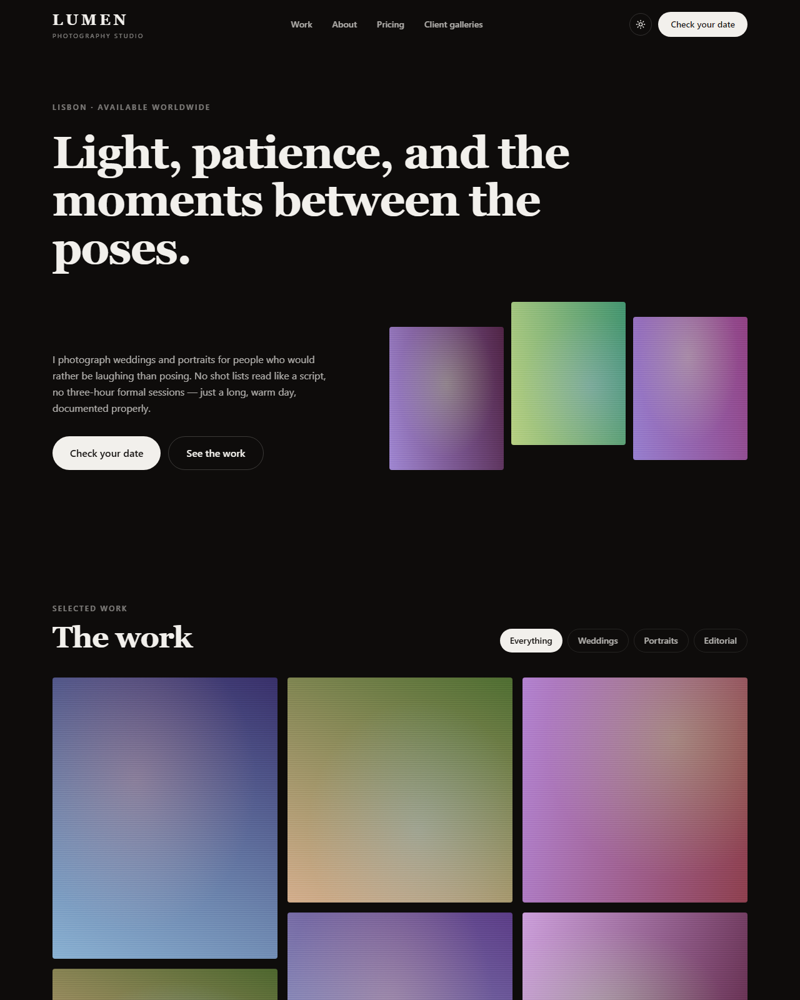

# 📷 Lumen — Free Photography Portfolio Website Template

**A production-ready photography portfolio template built with Next.js 15, TypeScript, and Tailwind CSS v4.** Filterable masonry galleries, a keyboard-accessible lightbox, pricing, and a client-proofing page. Clone it, edit one config file, deploy for free.

**[Live demo →](https://pixelandoak-lumen.pages.dev)**
**[Template page →](https://pixelandoak.com/templates/photography-portfolio-website-template/)**



## Why this one

Photography portfolios have a specific problem: they are the heaviest sites on the web, built by people whose work deserves to load instantly. Most portfolio templates ship 40MB of demo photographs and a carousel library.

Lumen ships **zero image files**. Every frame is a deterministic CSS gradient, so the repo is tiny and the demo is instant. When you add your own photographs, you are adding the *only* images on the site.

- 🖼️ **Filterable masonry gallery** — CSS columns, no layout library, no reflow jank
- 🔍 **Lightbox with real keyboard support** — arrow keys, Escape, focus-safe, scroll-locked, `role="dialog"` + `aria-modal`. About 100 lines of React, no dependency
- 🔒 **Client proofing page** — gallery-code entry, correctly `noindex, nofollow` so private galleries never reach Google
- 💶 **Pricing + process + FAQ** — the three things that stop the "how much?" email, with `FAQPage` structured data for rich results
- 📍 **Local SEO** — `ProfessionalService` schema so you can rank for "*city* wedding photographer"
- 🌙 **Real dark mode** — class strategy, localStorage, OS detection, no flash
- 🎞️ **Zero image dependencies** — nothing to license, nothing to optimise, nothing slow
- ⚙️ **One-file customization** — galleries, packages, FAQs, and copy all in `config/site.ts`
- 📦 **Fully static export** — `/out` deploys to any static host, free
- 📱 **Responsive** — tested from 375px, mobile nav panel, no horizontal scroll

## Quick start

```bash
git clone https://github.com/haider484991/lumen-nextjs-photography-template.git my-portfolio
```

```bash
cd my-portfolio && npm install && npm run dev
```

Open [http://localhost:3000](http://localhost:3000).

## Make it yours

Everything lives in **`config/site.ts`**:

```ts
export const siteConfig = {
  name: "Lumen",
  photographer: "Ada Okonkwo",
  title: "Lumen — Wedding & Portrait Photography in Lisbon",

  galleries: [
    {
      slug: "weddings",
      name: "Weddings",
      blurb: "Full-day coverage, documentary-leaning, always unhurried.",
      shots: 9,
      ratios: ["portrait", "landscape", "square" /* … one per shot */],
    },
  ],

  packages: [
    { name: "Wedding — full day", price: "€2,400", duration: "10 hours",
      features: ["600+ edited photographs", /* … */], featured: true },
  ],
};
```

`ratios` accepts `"portrait"` (4:5), `"landscape"` (3:2), and `"square"` — mix them and the masonry grid does the rest.

## Using real photos

Replace the placeholder in **`components/Frame.tsx`** with `next/image`:

```tsx
import Image from "next/image";

<div className={`relative overflow-hidden rounded-sm ${RATIO_CLASS[ratio]}`}>
  <Image
    src={src}                       // e.g. `/galleries/${seed}/${index}.jpg`
    alt={alt}                       // describe the photograph — this is real SEO
    fill
    sizes="(max-width: 640px) 100vw, (max-width: 1024px) 50vw, 33vw"
    className="object-cover"
  />
</div>
```

Keep the wrapper and its aspect-ratio class — the masonry layout depends on them. `next/image` lazy-loads by default, which matters once a gallery has 60 photographs in it.

Because this template uses `output: "export"`, `next.config.ts` sets `images.unoptimized = true`. If you want automatic resizing, either deploy on a host that runs the Next.js image optimizer, or pre-resize your exports (which most photographers are already doing on the way out of Lightroom).

## Connecting the client gallery

`components/ProofingForm.tsx` is a front-end shell on purpose — a static site cannot verify a password, and pretending otherwise would be insecure theatre. Point `handleSubmit` at your real gallery host (Pic-Time, Pixieset, ShootProof, CloudSpot) or your own API and redirect on success.

## Deploy

```bash
npm run build
```

Emits `/out`. Deploy anywhere:

```bash
npx wrangler pages deploy out
```

Netlify, Vercel, GitHub Pages, and any static host work identically. Preview the production build with `npm run preview`.

## Tech

Next.js 15 (App Router, static export) · React 19 · TypeScript · Tailwind CSS v4 · zero runtime dependencies beyond React.

## License

MIT — free for personal and commercial use. Attribution appreciated but not required.

---

Built by [Pixel & Oak](https://pixelandoak.com/templates/photography-portfolio-website-template/) — web design and AI development studio.
More free templates: [Nova (blog)](https://github.com/haider484991/nova-nextjs-blog-template) · [LaunchPad (SaaS)](https://github.com/haider484991/launchpad-nextjs-saas-template) · [Table & Fork (restaurant)](https://github.com/haider484991/tablefork-nextjs-restaurant-template)
